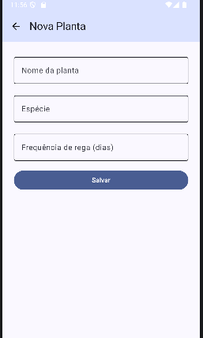
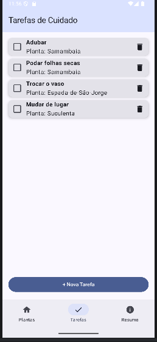
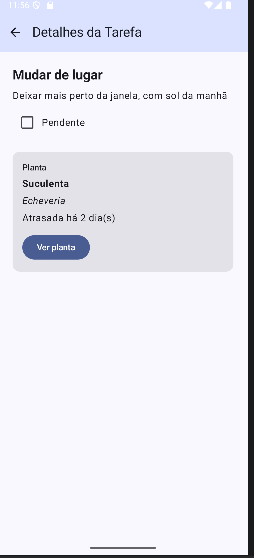

# BrotoApp

App de plantas feito em Jetpack Compose. Cadastra as plantas, mostra quando precisa regar e tem uma lista de tarefas de cuidado (adubar, podar, trocar vaso).

Trabalho 2 (MAF) - continuação do Trabalho 1.

Integrantes:
- Fhael Saporiti Vispo
- Bruno Burkner

## Como rodar

Abrir a pasta no Android Studio, esperar o Gradle sincronizar e rodar no emulador ou celular.

## Telas

- Plantas
- Tarefas
- Resumo
- Nova Planta
- Nova Tarefa
- Detalhes da Planta
- Detalhes da Tarefa

Plantas, Tarefas e Resumo ficam na barra de baixo. Os dados ficam só na memória.

## Documentação

No Trabalho 1 o app tinha 3 telas (lista de plantas, detalhe e adicionar planta). A troca de tela era feita por uma variável de texto no MainActivity, só tinha um tipo de item (Plant) e a lista começava com 3 plantas fixas.

Pra chegar até aqui trocamos essa variável por NavHost com NavController, então agora a navegação é de verdade e o detalhe recebe o id da planta pela rota. Também criamos um segundo tipo de item (CareTask), mais 4 telas, a barra de baixo e a barra de cima com o botão de voltar. Nas 3 telas antigas, o botão de voltar e o título foram pra barra de cima.

Também mudamos o Plant: o lastWatered (texto com a data) virou daysSinceWatered (número de dias desde a última rega), pra dar pra calcular quando é a próxima rega. E a lista de plantas ganhou um botão de remover.

Lista de plantas e cadastro de planta:

 

Criamos as telas de tarefas porque cuidar de planta não é só regar. Cada tarefa é ligada a uma planta. A tela de resumo mostra os números gerais e deixa regar todas as atrasadas de uma vez.

  

As rotas ficam no objeto Rotas e o NavHost no AppNavigation.kt. As listas ficam no BrotoApp e cada tela recebe o navController.

No detalhe da planta calcula a próxima rega, dá pra mudar a frequência ali mesmo e mostra as tarefas daquela planta. Escolhemos isso porque a frequência de rega é o dado principal da planta.

O detalhe da tarefa mostra a planta ligada a ela, com um botão pra abrir o detalhe da planta.

Dificuldades: na hora de rodar o projeto no Android Studio deu uns 60 erros de "Unresolved reference" (icons e navigation). Faltavam as dependências do navigation-compose e do material-icons, e na primeira tentativa colocamos as linhas dentro do bloco android {} do build.gradle.kts, por isso continuava vermelho. Resolvemos movendo as duas linhas pro bloco dependencies {} e sincronizando o Gradle.
